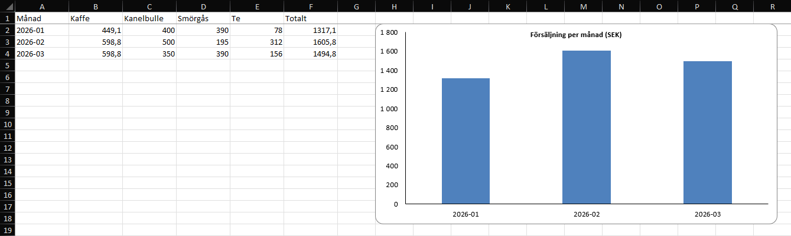

# CSV till Excel – automatisk rensning och rapport

Ett Pythonprogram som tar röriga CSV-exporter (t.ex. från ett kassasystem eller en webbutik), rensar dem och skapar en färdig Excelrapport – med ett klick i stället för en eftermiddag i Excel.



## Vad programmet gör

1. Läser in alla CSV-filer i mappen `data/` och slår ihop dem.
2. Tar bort **exakta dubbletter** – även när samma order finns i flera filer. Första förekomsten behålls.
3. **Flaggar rader med saknade uppgifter** och utesluter dem. Inga värden gissas.
4. Räknar ut försäljning (antal × styckpris).
5. Skapar `output/rapport.xlsx` med fyra flikar:
   - **Rensad_data** – godkända rader, sorterade på datum
   - **Per_manad** – försäljning per månad och produkt, med diagram
   - **Per_produkt** – sålt antal och försäljning per produkt
   - **Dataproblem** – varje utesluten rad med fil, radnummer och orsak
6. Skriver en logg (`output/rapport.log`) över allt som togs bort och varför.

Originalfilerna ändras aldrig, och programmet kan köras om hur många gånger som helst.

## Exempel

Med testdatan i `data/` (30 rader i tre filer):

| | Rader |
|---|---|
| Inlästa | 30 |
| Borttagna dubbletter | 3 |
| Saknade värden | 3 |
| **Godkända** | **24** |

Färdig rapport: [`exempel/rapport_exempel.xlsx`](exempel/rapport_exempel.xlsx)

## Kom igång

Kräver Python 3.10 eller senare.

```powershell
python -m venv .venv
.venv\Scripts\pip install -r requirements.txt
.venv\Scripts\python rapport.py
```

Testdatan kan återskapas med `python skapa_testdata.py`.

## Indata

CSV-filer med kolumnerna `order_id, date, product, quantity, unit_price_sek`.
Filerna läses i namnordning, så döp dem efter datum (`forsaljning_2026-01.csv`) – då behålls alltid den tidigaste kopian av en dubblett.

## Anpassning

Programmet är byggt för att lätt kunna anpassas till andra kolumner, filformat (semikolon, svenska decimaltecken), fler kontroller eller andra sammanställningar.

---
Kenneth · [Kenneth-Johansson@outlook.com]
